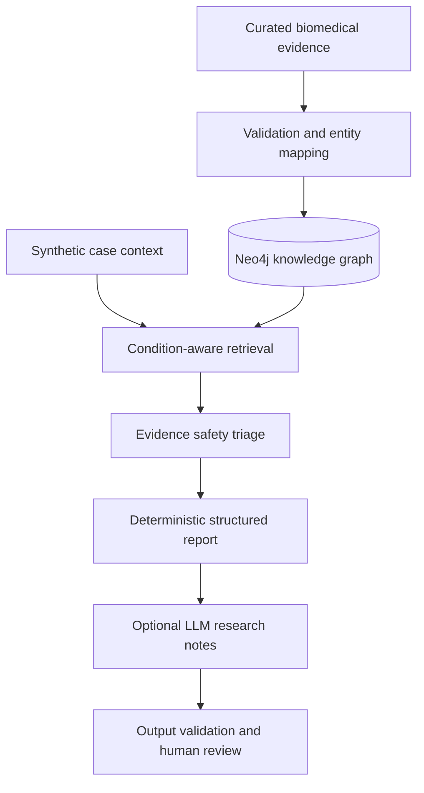

# OncoKG

**An evidence-traceable oncology knowledge graph research prototype**  
*Neo4j · Python · Condition-aware Retrieval · Evidence Safety Triage · LLM Reporting*

> **Research prototype — not for clinical use.** OncoKG is an experimental system for exploring how structured biomedical evidence can support context-aware retrieval and constrained language-model reporting. It does **not** provide medical advice, prescribe treatment, establish drug safety, or replace expert review.

## Overview

OncoKG investigates a knowledge graph-enhanced approach to retrieving and organizing evidence relevant to oncology treatment research. The current proof of concept focuses on **non-small cell lung cancer (NSCLC)** and **EGFR** alterations, including **L858R** and **T790M**.

Rather than asking a language model to infer treatment decisions from memory, the prototype separates evidence retrieval, patient-context matching, safety-evidence triage, and report generation. Its aim is to make research outputs more **traceable, testable, and explicit about uncertainty**.

## System architecture



The LLM generation stage is **optional and still under integration**. An offline, deterministic reporting path is available; live GLM API calls have **not yet been demonstrated as reliably successful**.

## Current development status

| Component | Status |
| --- | --- |
| Neo4j schema and graph construction | Prototype implemented |
| Evidence validation and provenance queries | Prototype implemented |
| EGFR L858R / T790M evidence representation | Prototype implemented |
| Context-aware evidence matching | Local tests and database read-only demo completed |
| Safety-evidence triage | Initial rule-based prototype; **not** clinical safety validation |
| Deterministic JSON / Markdown reporting | Demo completed |
| External LLM adapter | Local tests complete; live API integration in progress |
| Evaluation | Offline engineering regression and synthetic retrieval pilot implemented. Independent labels and formal comparisons are pending. |

**Illustrative local graph snapshot (Schema v0.2):** 23 nodes, 32 relationships, and 5 evidence claims. These counts describe a small prototype, **not** a comprehensive clinical knowledge base or performance benchmark.

## Repository layout

```text
OncoKG/
├── codes/demo/
│   ├── validate_seed.py
│   ├── import_neo4j.py
│   ├── import_real_evidence.py
│   ├── import_t790m_incremental.py
│   ├── condition_retrieval.py
│   ├── safety_triage.py
│   ├── mock_report.py
│   ├── llm_report.py
│   └── test_*.py
├── data/
│   └── samples/               # Synthetic examples only
├── docs/                       # Design and evaluation protocol
├── .gitignore
└── README.md
```

Some research inputs and results, including `data/curated/` and `docs/results/`, are deliberately excluded from the public repository pending review. Consequently, **not every data-dependent script can run from a fresh clone**. See the availability notes below.

## Getting started

Requirements: **Python 3.10+**. Graph-backed workflows also use a Neo4j server (for example, Neo4j Desktop) and the Python driver. Commands below are run from the repository root.

```bash
python3 -m venv codes/demo/.venv
source codes/demo/.venv/bin/activate
# Required for Neo4j-backed commands
python -m pip install neo4j==5.28.2
```

### Example: local demo validation

```bash
python codes/demo/validate_seed.py
```

### Run synthetic-case tests

The full condition-retrieval, safety-triage, and reporting tests depend on curated evidence JSON files that are **not included** in this public snapshot. Once those inputs are supplied in the expected local paths and checked against their source records, the corresponding tests can be run with:

```bash
python codes/demo/test_condition_retrieval.py
python codes/demo/test_safety_triage.py
python codes/demo/test_mock_report.py
python codes/demo/test_llm_report.py
```

### Optional offline report (requires the local curated evidence inputs)

```bash
python codes/demo/mock_report.py \
  --offline \
  --case-id SYN-T790M-001 \
  --output docs/results/task06_mock_t790m.json
```

**Do not commit API keys, local passwords, real patient data, or unapproved source files.** Live model calls are optional, may be rate-limited, and require an appropriately configured provider account.

## Offline evaluation

Task 07A checks four existing synthetic development cases against fixed engineering expectations. The separate retrieval pilot compares a lexical BM25 baseline, variant-only reranking and full context reranking over eight new developer-annotated synthetic cases. Both runs use approved local curated evidence files. The pilot uses no external model or database connection.

```bash
python codes/demo/benchmark_task07.py --offline
python codes/demo/task07_retrieval_pilot.py --k 3
```

See the [Task 07 protocol](docs/task07_protocol_v0_1.md) for inputs, denominators, ablations and the independent evaluation design.

### Retrieval experiments

- [Task 15 retrieval comparison](docs/task15_retrieval_comparison.md) runs BM25,
  MiniLM, rank fusion and Neo4j path and context rankings on the same development cases.
- [Task 16 retrieval audit](docs/task16_retrieval_audit.md) recomputes metrics
  across cutoffs and checks how individual cases affect the paired comparisons.

- [Task 17 report experiment](docs/task17_report_context.md) projects each
  ranking into a local research report with source and missing-field checks.
- [Task 23 review-support audit](docs/task23_review_support.md) tests a
  conservative evidence selection rule at a fixed three-row report budget.
- [Task 24 applicability-limit counterexample](docs/task24_applicability_limits.md)
  checks when a sourced eligibility note should keep its report slot.
- [Task 25 trial applicability demo](docs/task25_trial_applicability.md) uses
  structured trial and population identifiers to qualify report outcomes.
- [Task 26 presentation bundle](docs/task26_applicability_demo.md) replays the
  Task 23–25 comparison and packages all synthetic inputs and reports.

## Evidence handling and limitations

- The current examples use **synthetic case contexts**, not real patient records.
- Claims are associated with source identifiers and provenance; inclusion in the graph **does not mean independent medical verification**.
- A `CONTEXT_MATCHED` label refers only to a research rule's evidence-context match; it **does not mean a drug is suitable or recommended**.
- A resistance association is **not** equivalent to a contraindication. Unknown information must remain unknown rather than be treated as absent.
- Contraindication, interaction, and complete treatment-safety coverage are **not implemented or clinically validated**.
- Automated tests confirm engineering behavior against current fixtures; they do **not** establish clinical accuracy, generalizability, or superiority over baseline methods.

## Roadmap

- [x] Initial NSCLC / EGFR knowledge graph and provenance queries
- [x] Condition-aware retrieval over synthetic cases
- [x] Initial evidence safety triage and deterministic report generator
- [ ] Stabilize live LLM integration and validate generated notes
- [ ] Create independently reviewed benchmark cases and labels
- [ ] Compare plain LLM, vector RAG, and KG-enhanced retrieval under the same evaluation protocol
- [ ] Conduct ablation studies and report limitations
- [ ] Expand source coverage and cancer types after validation

## Project status and reuse

**Work in progress.** This repository documents a bounded research prototype. Any extension to clinical or real-patient settings would require appropriate approvals, source verification, privacy safeguards, and independent clinical review.

No open-source licence has been granted in this repository at present. Public visibility alone does not imply permission to reuse third-party data or code.
