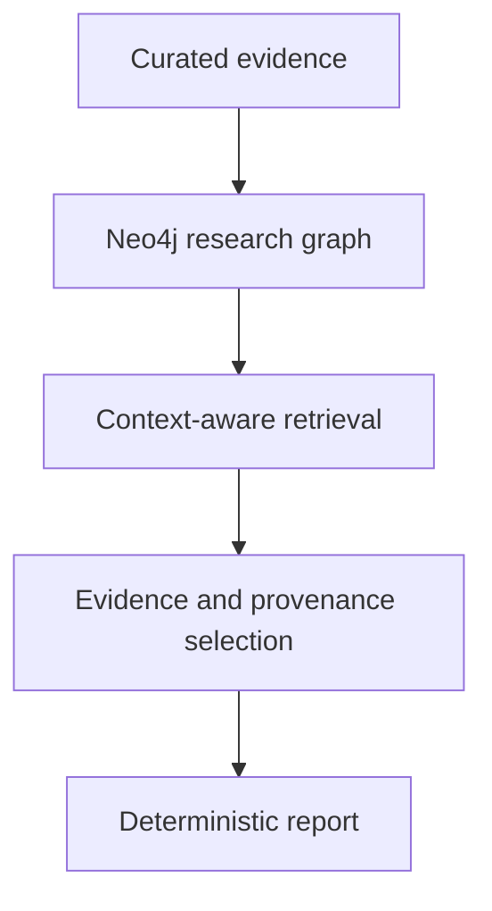

# OncoKG prototype handover

## Architecture



The graph-backed pilot uses a small NSCLC/EGFR snapshot. The Task 26
applicability branch uses a separate prestructured synthetic fixture.

## Reproduce the synthetic demonstration

From the repository root with Python 3.10 or later:

```sh
python codes/demo/task26_applicability_demo.py build --bundle docs/results/OncoKG-Task26-Demo.zip
python codes/demo/task34_source_dependencies.py
python -m unittest discover -s codes/demo -q
```

Use a fresh path when building. Open comparison.md in the ZIP for the
Task 23–25 comparison. Task 34 prints baseline and source-complete
selection results for each synthetic fixture and budget. The full test
suite uses the existing repository fixtures.

## Inspect the evidence and limits

- [Retrieval comparison](task15_retrieval_comparison.md) compares seven configurations on the same development cases.
- [Task 27](task27_applicability_boundary.md) isolates evidence outside the cutoff.
- [Task 28](task28_applicability_promotion.md) shows what a single swap displaces.
- [Task 29](task29_evidence_budget.md) enumerates the three-source alternatives.
- [Task 30](task30_primary_outcome.md) checks an explicit primary-outcome priority.
- [Task 31](task31_evidence_budget_sweep.md) enumerates feasible selections at budgets 2–4.
- [Task 32](task32_report_budget.md) checks how report citations and flags follow the visible evidence.
- [Task 33](task33_budget_comparison.md) compares 21 budget-matched synthetic pairs.
- [Task 34](task34_source_dependencies.md) checks multi-source review dependencies on 15 synthetic pairs.

The demonstration is reproducible with synthetic inputs. Independent labels,
real trial extraction and graph integration for the applicability branch,
and the live LLM end-to-end run remain pending.

## Acceptance milestones

| Milestone | Status | Evidence or dependency |
| --- | --- | --- |
| Working-tree prototype | Verified | 140 local tests passed. The Task 26 demo rebuilt at a fresh path and matched the existing archive byte for byte. |
| Remote handover | Pending | Choose the files for delivery and approve any GitHub push or external sharing. The latest replay was verified on the local working tree. |
| Independent evidence-context assessment | Pending | [Review packet instructions](task11_reviewer_instructions.md). Two reviewers independently annotate 60 case–claim pairs each, followed by adjudication and reference freezing. |
| Real trial applicability integration | Pending | Extract and verify real trial, population and eligibility mappings, then connect them to the graph. |
| Live LLM validation | Pending | Working credentials or quota and an end-to-end validation run. |

## Prototype delivery checklist

- Use this handover as the entry point for the architecture, reproduction
  commands, and evidence-coverage limitations.
- Include the Task 26 demo ZIP and the Task 34 source-dependency experiment
  as the two worked examples. Include the research log through Task 35.
- Record the verification environment (Python 3.12.14), the test count,
  and the demo rebuild result in the delivery summary.
- For a shared repository revision, review the working-tree diff before
  selecting files and rerun the commands against the selected revision.
